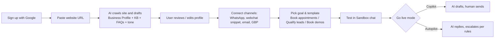
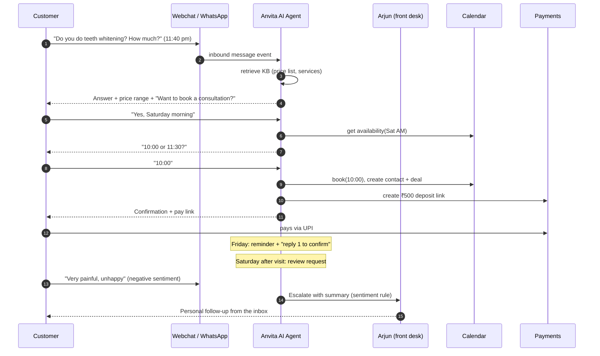
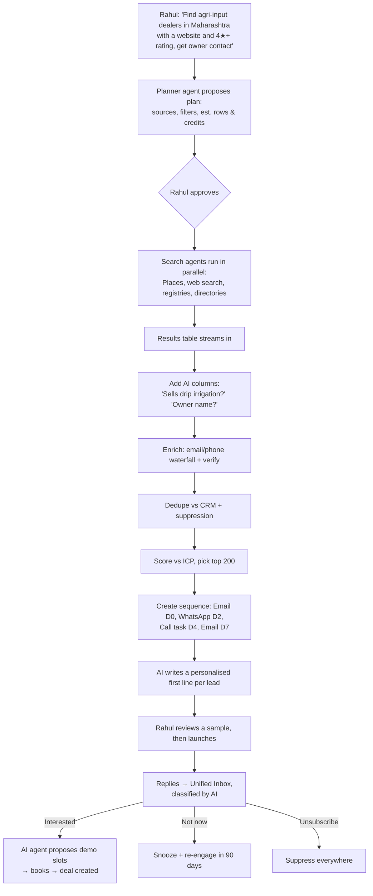

# 03 — User Journeys

## Personas

| Persona | Example | Main job-to-be-done | Modules used |
|---|---|---|---|
| **Priya, owner of a local business** | Owner of a 2-location dental clinic | "Never miss a patient enquiry. Fill my calendar. Get more 5★ reviews." | Inbox, AI Agent, Booking, Reviews, Payments, Campaigns |
| **Rahul, B2B founder / SDR** | Sells farm-IoT or SaaS to SMBs | "Find the right companies, reach them, and book demos." | Prospecting, Sequences, Inbox, AI Agent, Pipeline |
| **Meera, marketing manager / agency** | Runs marketing for 10 clients | "Show ROI on spend, produce content, and report without manual work." | Ads co-pilot, SEO agent, Analytics, Agency mode |
| **Arjun, front-desk / sales rep** | Handles conversations the AI escalates | "See what the AI did and step in fast." | Inbox (mobile), Copilot |
| **End customer** | Patient, buyer, farmer | "Get an answer now, on WhatsApp, in my language." | Webchat, WhatsApp, Booking link, Pay link |

---

## Journey 0: Onboarding (all personas). Target: first value in under 15 minutes.

| Step | User sees | System does | Success metric |
|---|---|---|---|
| 1. Sign up | 1-click Google/Microsoft | Creates org, default location, trial credits | Sign-up → URL pasted > 70% |
| 2. Website import | Live progress "Reading 23 pages…" | Crawler + LLM extraction → services, hours, prices, FAQs, ICP. Embeds into the KB. | Profile accepted with < 5 edits |
| 3. Channels | Wizard cards with status ticks | WhatsApp Embedded Signup (Meta), number provisioning, widget snippet, OAuth for Gmail/Outlook/GBP | ≥ 1 channel connected |
| 4. Goal | Template gallery by industry | Installs playbooks, escalation defaults, booking settings | Template chosen |
| 5. Sandbox | Chat with own AI, edit answers inline | Runs the agent against the draft config. Edits become KB entries. | ≥ 3 test messages |
| 6. Go live | Copilot/Autopilot toggle | Activates channel routing to the agent | First real conversation in 24h |

---

## Journey 1: Inbound lead → booked → paid → reviewed (Podium-style)

**Persona:** Priya's clinic. The end customer is a new patient.

**Touchpoints & automations:**
1. **Capture:** webchat, WhatsApp click-to-chat ad, missed call → auto text-back, GBP message.
2. **Respond:** median first response under 60 s, 24/7, in the customer's language.
3. **Qualify:** playbook asks the required fields (service, preferred time, name, phone).
4. **Book:** real-time availability → booking → calendar event → confirmation.
5. **Pay:** deposit or full payment link. Payment status is written back to the deal.
6. **Remind:** T-24h and T-2h reminders. Rescheduling is handled in chat.
7. **Review:** 2h after the visit, a review request. Happy customers get a Google link. Unhappy ones go
   to a private feedback form and the owner is alerted.
8. **Retain:** at 6 months, a "cleaning due" re-engagement campaign.

**Edge cases the agent must handle:** questions outside the KB (say "I'll check" and escalate),
medical/legal advice (refuse and hand off), price negotiation (follow policy), a human already in the
thread (AI stays silent), STOP/unsubscribe, abusive messages.

---

## Journey 2: Outbound prospecting → sequence → demo (Origami-style)

**Persona:** Rahul, B2B founder.

**Key UX details**
- Show the **plan and the credit estimate before running.** Users trust agents more when they can see
  the plan.
- Results **stream** into the table so it's never a blank spinner.
- Every enriched field shows its **source and confidence**.
- Sequence safety: daily caps per mailbox, warm-up status, required unsubscribe link, WhatsApp only
  with approved templates and a lawful basis.

---

## Journey 3: Marketing manager / agency (Different-style AI demand gen)

**Persona:** Meera, who runs 10 client workspaces.

1. **Connect** Google Ads, Meta Ads, GA4, Search Console and the client website.
2. **Monday AI growth report** (auto-generated): spend, CPL by campaign, leads → bookings → revenue
   (because Anvita owns the conversation and the booking, attribution is closed-loop), and the top 3
   recommendations ("Shift ₹15k from Campaign B to A: 2.3× lower cost per *booked* lead").
3. **Approve actions** in one click: budget shifts and new ad variants. Every change is logged and can
   be reverted.
4. **Content:** the SEO agent proposes this month's 8 topics from Search Console gaps. Meera approves,
   the agent drafts, Meera edits, and the post publishes to WordPress. Social snippets are generated
   automatically.
5. **Client reporting:** a white-label PDF/link per client.

---

## Journey 4: Human-in-the-loop (front desk / sales rep)

1. Push notification: *"Escalated: angry customer, Booking #1042"*, with an AI-written 3-line summary.
2. Open the thread on mobile and see the full AI transcript plus the reason for escalation.
3. Pick a suggested reply (Copilot) or type a reply. The AI pauses on this thread until it is released.
4. Resolve → tag the outcome. Optionally click **"Teach AI"**, which turns the human answer into a KB
   entry after manager approval.

---

## Journey 5: Owner reviewing AI quality (Agent Studio)

1. Dashboard: AI resolution rate, escalation rate, CSAT, bookings by AI vs humans.
2. **Conversation QA:** an AI grader flags conversations with hallucination risk, policy breaches or
   missed booking opportunities.
3. Fix: edit the KB/playbook → re-run saved test scenarios in the **sandbox** → publish a new version
   (with rollback).

---

## North-star & journey metrics

| Metric | Target |
|---|---|
| **North star:** revenue-generating outcomes per workspace per month (bookings + paid + demos) | ↑ |
| Time to first live conversation | < 1 day |
| Median first response time | < 60 s |
| AI resolution without human (Autopilot) | > 60% |
| Lead → booking conversion | +30% vs baseline |
| Review request → review left | > 15% |
| Prospect row → valid contact | > 50% |
| Sequence reply rate | > 5% |
