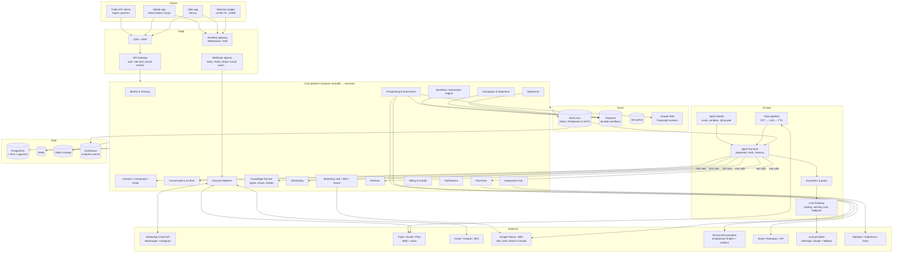
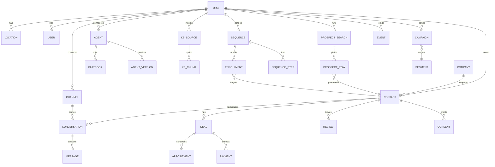
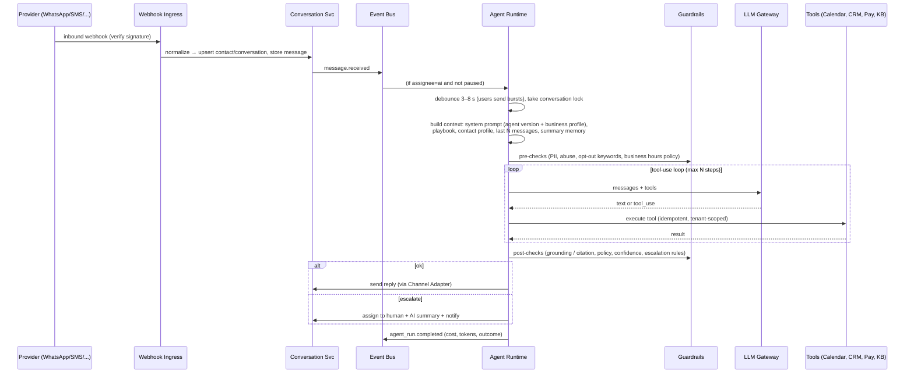
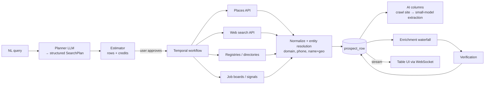

# 04 — Technical Architecture

## 1. Design principles
1. **One customer graph.** Prospects, leads, contacts and customers are the same `contact` entity
   moving through stages. Every channel and module reads and writes that record.
2. **Event-driven core.** Every message, booking, payment or review is an event. Agents, automations,
   analytics and webhooks subscribe to events.
3. **Durable workflows for anything long-running.** Sequences, reminders, prospecting runs and agent
   follow-ups must survive restarts and be retryable.
4. **Agents are tool-using LLM loops with guardrails.** Business logic lives in tools and services,
   never only in prompts.
5. **Multi-tenant from day 1.** Every row carries `org_id`, enforced by Postgres RLS.
6. **Start as a modular monolith and split services only when scale requires it.**

## 2. High-level architecture



## 3. Recommended tech stack

| Layer | Choice | Why |
|---|---|---|
| Web frontend | **Next.js (React, TypeScript)**, Tailwind, shadcn/ui, TanStack Query | Fast to build. SSR for marketing and booking pages. |
| Mobile | **React Native (Expo)** | Shares types and logic with web. Push via Expo/FCM/APNs. |
| Webchat widget | Vanilla TypeScript + Preact, served from CDN, Shadow DOM | Small bundle, no CSS clashes on customer sites |
| Backend API | **TypeScript (NestJS or Fastify)**, or **Python (FastAPI)** | Pick one main language. Recommendation: **Python/FastAPI** for both API and agents, since the AI, crawling and data ecosystem is strongest there. |
| Agent runtime | Python, using the Anthropic SDK directly (tool use) behind your own thin orchestration layer | Full control over the tool loop, streaming, cost tracking and guardrails |
| Durable workflows | **Temporal** | Sequences with waits of days, reminders, retries, prospecting fan-out |
| Event bus | **Redpanda/Kafka** (or NATS JetStream early on) | Fan-out to agents, analytics, webhooks, integrations |
| Primary DB | **PostgreSQL 16** + RLS + **pgvector** | One DB for OLTP and embeddings until roughly 10M chunks |
| Cache / presence / rate limits | **Redis** | Typing indicators, per-tenant throttles, locks |
| Analytics | **ClickHouse** | Event-scale dashboards and attribution queries |
| Search (optional, later) | OpenSearch / Typesense | Inbox and contact full-text search at scale |
| Object storage | S3 / GCS | Attachments, crawled pages, call recordings |
| Crawling | **Playwright** workers + HTTP fetch tier, rotating egress, robots.txt-aware | Website import, prospect research |
| Voice | Telephony (Twilio / Exotel for India) → streaming STT (e.g. Deepgram) → LLM → streaming TTS (e.g. ElevenLabs), or a native speech-to-speech model | Target < 800 ms turn latency |
| Infra | **AWS** (Mumbai region for India data residency) or GCP. Kubernetes (EKS) or ECS. Terraform. | |
| Observability | OpenTelemetry → Grafana/Tempo/Loki or Datadog. **Langfuse** (or similar) for LLM traces. | |
| Auth | Clerk / Auth0 / WorkOS, or self-hosted (Keycloak) | SSO, MFA, org management |
| Feature flags | Unleash / GrowthBook | Safe rollouts of agent versions |

## 4. Core domain model



Key tables (abridged):
- `contact(id, org_id, company_id, name, phones[], emails[], whatsapp_id, stage, source, utm, owner_id, score, attributes jsonb, created_at)`
- `conversation(id, org_id, contact_id, channel_id, status[open|pending|closed], assignee_type[ai|human], assignee_id, ai_paused_until, last_message_at)`
- `message(id, conversation_id, direction, author_type[contact|ai|human|system], body, attachments, provider_msg_id, status, ai_run_id, created_at)`
- `agent_run(id, org_id, conversation_id, agent_version_id, input_tokens, output_tokens, cost, tool_calls jsonb, outcome, latency_ms)`
- `consent(contact_id, channel, purpose[marketing|transactional], status, source, captured_at)`: required for WhatsApp/SMS/email compliance
- `credit_ledger(org_id, delta, reason, ref_id, created_at)`: usage billing

## 5. The AI Agent runtime

### 5.1 Message handling flow



### 5.2 Tools exposed to the agent (examples)
| Tool | Purpose |
|---|---|
| `search_knowledge(query)` | Hybrid retrieval over pgvector + keyword search, returns chunks with source ids |
| `get_contact()` / `update_contact(fields)` | Read and write the CRM record (only whitelisted fields) |
| `check_availability(service, date_range, location)` | Scheduling service |
| `book_appointment(slot_id)` / `reschedule` / `cancel` | Idempotent with an idempotency key |
| `create_payment_link(amount, purpose)` | Bounded by per-org maximum amount rules |
| `create_task(type, due_at, note)` | Follow-up memory ("call back Tuesday") |
| `handoff_to_human(reason, summary)` | Escalation |
| `send_template(template_id, vars)` | WhatsApp templates outside the 24 h window |
| `lookup_inventory(query)` | Catalogue / inventory / price list (vertical playbooks) |

### 5.3 Model routing (via LLM Gateway)
| Task | Model tier |
|---|---|
| Live customer conversations with tool use | Mid tier, e.g. `claude-sonnet-5-5` |
| Classification (intent, sentiment, reply type), extraction, summaries, AI table columns at scale | Small/fast tier, e.g. `claude-haiku-5-5` |
| Prospect search planning, growth reports, SEO long-form, QA grading | Top tier, e.g. `claude-opus-5-5` |
| Embeddings | A multilingual embedding model (must handle Hindi and regional languages) |

The gateway handles prompt caching (the system prompt and business profile are stable, so they cache
well), per-tenant budgets, retries, provider fallback, PII redaction in logs, and token/cost metering
into `credit_ledger`.

### 5.4 Guardrails
- **Grounding:** factual claims about the business (price, hours, policy) must come from KB or tool
  results. Otherwise the agent says it will confirm and escalates.
- **Escalation rules engine:** keywords, negative sentiment, low confidence, VIP contacts, refund
  or complaint intents, repeated misunderstanding, explicit "talk to human".
- **Action limits:** max discount, max payment amount, which calendars can be booked, no
  medical/legal/financial advice.
- **Human-in-control:** if a human replied in the last X minutes, the AI is paused on that thread.
- **Prompt-injection defence:** customer messages and crawled web content are treated as data, and
  tools are tenant-scoped server-side.

### 5.5 Agent Studio (evals)
- Versioned `agent_version` (prompt + playbooks + KB snapshot + model).
- Test suites of scripted multi-turn scenarios with an LLM-as-judge plus deterministic asserts (e.g.
  "booked exactly one slot").
- Shadow mode: a new version runs on live traffic without sending, and its replies are compared with
  the current version.
- Nightly QA sampling of production conversations to give a quality score per org.

## 6. Prospecting engine (Origami-style)



- **Waterfall enrichment:** a configurable ordered list of providers per field. Stop at the first
  verified hit. Cache results globally (with TTL) so repeat lookups are cheap. Charge credits only on
  success.
- **Entity resolution:** match on domain → phone (E.164) → normalised name + geo. Then dedupe
  against the tenant CRM and suppression lists.
- **Compliance:** respect robots.txt and each source's terms of service. **Avoid scraping LinkedIn
  directly.** Use licensed data providers or user-driven tasks instead. Record data provenance per
  field (needed for GDPR/DPDP access requests).

## 7. Sequencer & campaigns
- Each enrollment is a **Temporal workflow**: `for step in steps: wait(delay, business_hours, tz) → check(stop_conditions) → send`.
- Stop conditions: reply, meeting booked, bounce, unsubscribe, manual stop. These are delivered as
  workflow signals from the event bus.
- Email deliverability: per-mailbox daily caps, randomised send times, warm-up, SPF/DKIM/DMARC
  checker, one-click unsubscribe header (RFC 8058), and bounce/complaint handling.
- WhatsApp: only Meta-approved templates outside the 24 h service window. Track quality rating and
  messaging tier. Opt-in is required.
- SMS: DLT registration in India, 10DLC in the US, STOP handling, quiet hours.

## 8. Channel adapters
A common interface lets new channels plug in without touching the inbox or the agent:

```text
interface ChannelAdapter {
  verifyWebhook(req) -> bool
  parseInbound(req) -> NormalizedMessage[]
  send(conversation, OutboundMessage) -> ProviderMessageId
  parseStatus(req) -> DeliveryStatus[]   // sent / delivered / read / failed
  capabilities() -> {templates, media, buttons, readReceipts, typing, windowHours}
}
```
Planned adapters: WhatsApp Cloud API, SMS (Twilio/Exotel/Plivo), Email (Gmail API push, Microsoft
Graph, inbound SMTP via SES), Webchat (native WebSocket), Instagram/Messenger, Google Business Profile,
Voice (call logs + recordings + AI voice).

## 9. Security, privacy & compliance
- Tenant isolation: Postgres RLS on `org_id`, plus a scoped service token per request. Each tenant
  has its own KMS data key for secrets (OAuth tokens, API keys).
- Encryption in transit (TLS 1.2+) and at rest. PII is redacted in logs and LLM traces.
- Regulations: **DPDP Act (India)**, **GDPR** (EU/Norway customers), **TCPA/CAN-SPAM** (US), **TRAI
  DLT** (India SMS), Meta WhatsApp Business policy. Consent ledger per contact, per channel, per
  purpose.
- LLM data: use provider settings that exclude customer data from training. Configurable retention.
- Audit log for every AI action (what it did, which tool it called, on what evidence).
- Targets: SOC 2 Type II by year 2. ISO 27001 if selling to enterprise.

## 10. Scalability & reliability targets
| Concern | Target / approach |
|---|---|
| Inbound webhook ack | < 200 ms (ack first, process async) |
| AI first response | p50 < 15 s, p95 < 60 s (including debounce) |
| Voice turn latency | < 800 ms |
| Availability | 99.9% for messaging paths |
| Idempotency | Provider message id + idempotency keys on every outbound send and tool call |
| Backpressure | Per-tenant queues and rate limits so one tenant's campaign can't starve another's live chats |
| Live chat vs bulk sends | Separate worker pools / priority classes |

## 11. Repository layout (proposed monorepo)

```text
anvita/
├── apps/
│   ├── web/                # Next.js dashboard + booking pages
│   ├── mobile/             # Expo app (inbox, notifications)
│   └── widget/             # Webchat embed
├── services/
│   ├── api/                # FastAPI modular monolith (iam, crm, conversations, scheduling, payments, reviews, campaigns, billing)
│   ├── agent/              # Agent runtime, tools, guardrails, LLM gateway client
│   ├── channels/           # Channel adapters + webhook ingress
│   ├── workflows/          # Temporal workers: sequences, reminders, prospecting, campaigns
│   ├── prospecting/        # Planner, source connectors, enrichment waterfall, entity resolution
│   ├── crawler/            # Playwright fetch workers
│   └── analytics/          # Event consumers → ClickHouse, reports
├── packages/
│   ├── shared-types/       # OpenAPI-generated TS types
│   └── ui/                 # Shared React components
├── evals/                  # Agent test scenarios + judge configs
├── infra/                  # Terraform, Helm charts
└── docs/                   # ← these documents
```

## 12. Delivery roadmap

| Phase | Duration | Scope | Exit criterion |
|---|---|---|---|
| **0. Foundations** | 3 wks | Auth, tenancy, Postgres/RLS, event bus, CI/CD, observability, design system | Deployed skeleton |
| **1. MVP: AI front desk** | 8–10 wks | Website import → KB, webchat + WhatsApp + email, unified inbox, AI agent (Copilot/Autopilot), booking, escalation, basic dashboard, mobile push | 10 design partners live. > 50% AI resolution. |
| **2. Convert & retain** | 6 wks | Payments links, reviews engine, campaigns + segments, re-engagement automations, Agent Studio v1 | Paid conversion of design partners |
| **3. Outbound** | 8 wks | Prospecting (chat search, table, AI columns, waterfall), sequencer, reply classification, CRM integrations | B2B users booking demos from Anvita lists |
| **4. Voice + marketing** | 8–10 wks | AI voice agent, ads co-pilot (read + recommend → approve), SEO/content agent, attribution, AI growth report | Closed-loop ROI report per workspace |
| **5. Platform** | ongoing | Public API, workflow builder, agency/white-label, marketplace of playbooks | |

**Why start with inbound (Podium-style) rather than prospecting:** it delivers value on day 1 with the
customer's existing traffic, and it builds the conversation core (inbox, channels, agent, contact
graph). Outbound replies have to land in that core anyway, so prospecting becomes an extension of it
rather than a separate product.

## 13. Team for MVP (suggested)
- 1 tech lead / architect
- 2 backend (Python), 1 of them focused on the agent runtime
- 2 frontend (React / React Native)
- 1 AI/ML engineer (retrieval, evals, prompts)
- 1 product designer, 1 PM (can be the founder)
- 0.5 DevOps / SRE (contract)
